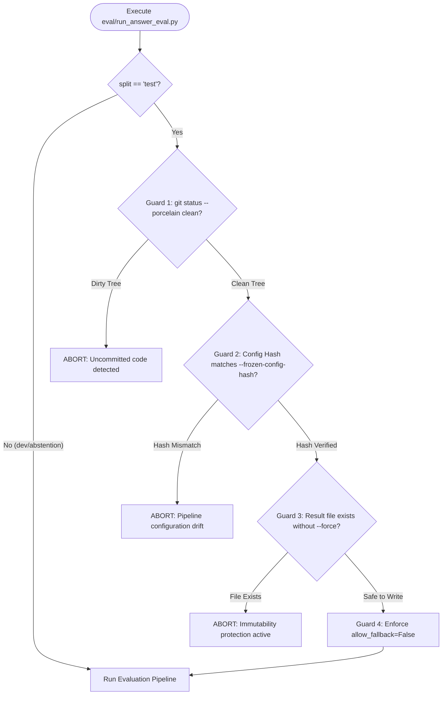

# FinVault AI: Evaluation Harness & Verification Guide

**Harness Script:** `eval/run_answer_eval.py`  
**Split Definition:** `eval/results/split_75_75.json` (Seed 42)  
**Frozen Config Hash:** `357e5de5955c06edec0c892289a2acdb3fefdebaa916ef8e302af52e82d03ebb`  

---

## 1. Overview & Architectural Integrity

The FinVault AI evaluation suite provides rigorous, reproducible benchmarking over SEC financial filings. It is designed to prevent common RAG evaluation pitfalls:
- Data leakage between development tuning and held-out testing.
- Silent API failure masking through fallback models.
- Subjective judge bias on pure numeric quantities.
- Stale or corrupted test runs through uncommitted code.

---

## 2. Safety Guards & Execution Gates

The harness enforces four strict gates before permitting evaluation against the held-out test split:



1. **Clean Git Tree Guard:** Runs `git status --porcelain`. Any unstaged edit, untracked script, or temporary file causes an immediate exception.
2. **Frozen Config Hash Guard:** Canonicalizes all pipeline parameters (prompt string, model names, retriever table, top-k, aliases hash, judge rubric) and computes its SHA-256 hash. If it does not match `--frozen-config-hash`, execution terminates.
3. **Single-Write Protection:** Held-out results are written once. Re-running requires passing `--force` explicitly to prevent accidental overwrites.
4. **Zero Fallback & Loud Failure:** `allow_fallback=False` is hardcoded. Any API error raises an immediate exception, logs `!!! LOUD EVAL FAILURE`, records the question in `metadata["failed_questions"]`, and proceeds.

---

## 3. Two-Stage Scoring Architecture

```mermaid
flowchart LR
    Pred[Predicted Answer] --> AbstentionCheck{check_abstention?}
    AbstentionCheck -- Yes --> Abstained[Verdict: abstained\nNo Judge Called]
    
    AbstentionCheck -- No --> NumCheck{try_numeric_match?\nGold is Pure Number}
    NumCheck -- Match <= 1.5% --> CorrectNum[Verdict: correct\nNumeric Tolerance Match]
    NumCheck -- Miss > 1.5% --> WrongNum[Verdict: wrong\nNumeric Tolerance Miss]
    
    NumCheck -- Qualitative/Complex --> Judge[LLM Judge Rubric\ndeepseek-flash]
    Judge --> JudgeVerdict[Verdict: correct | wrong\nLLM Judge Decision]
```

### 1. Abstention Checking (`check_abstention`)
Matches explicit statements of missing context, including:
- `"i cannot answer this question based on the provided filing excerpts"`
- `"cannot fully answer"` / `"unable to fully answer"`
- `"cannot definitively confirm"` / `"cannot confirm"`
- `"excerpts do not contain enough information"`
- `"is not stated in the provided excerpts"`

### 2. Scale-Aware Numeric Matching (`try_numeric_match`)
- Strips punctuation, currency signs (`$`, `€`, `£`), and fiscal year references (`FY2022`, `Q3`).
- Detects scale words (`billion`, `million`, `thousand`).
- Converts cross-unit representations (e.g. `$0.389 billion` matches `$389 million`).
- Applies a strict 1.5% relative tolerance:
  $$\frac{|V_{pred} - V_{gold}|}{\max(|V_{gold}|, 10^{-6})} \le 0.015$$

### 3. LLM Judge Rubric (`judge_answer`)
- Models: Configured via `JUDGE_MODEL` (default: `deepseek-flash`) using temperature 0.0.
- Binary verdict: strictly `correct` or `wrong` with a one-sentence rationale.
- Cached by `(question_hash, gold_hash, pred_hash, rubric_hash)` in JSONL.

---

## 4. Human Verification Review Files

When running with `--generate-reviews`, the harness automatically exports stratified sample files for human audit without automated scoring:

### 1. Sampled Judge Verdicts (20 Cases)
- **Path:** `eval/results/judge_verdicts_review_20_test_<hash>.md`
- **Stratification:** Samples all `wrong` verdicts and top-ups with random `correct` verdicts.
- **Audit Checklist:** Contains question, gold answer, predicted answer, judge reasoning, and manual `[ ] Agree` / `[ ] Disagree` checkboxes.

### 2. Sampled Citation Support Pairs (30 Pairs)
- **Path:** `eval/results/citation_support_review_30_test_<hash>.md`
- **Methodology:** Extracts bracketed citation references (e.g. `[1]`, `[2]`) from non-abstained predictions, pairs each claim with the exact retrieved text chunk, and generates a formatted audit file:
  ```markdown
  ### Pair 1.1 ([10] BESTBUY_2023_10K FY2023 p.28)
  - Claim: Operating activities provided $1,824 [10].
  - Cited Chunk Text:
  Operating activities $  1,824   $  3,252   $  4,927 ...
  - Support Check: [ ] Supported  [ ] Partial  [ ] Unsupported
  ```

---

## 5. Execution Commands

### Reproducing Held-Out Evaluation
```bash
./venv/bin/python3 eval/run_answer_eval.py \
  --split test \
  --prompt-version v0 \
  --frozen-config-hash 357e5de5955c06edec0c892289a2acdb3fefdebaa916ef8e302af52e82d03ebb \
  --generate-reviews
```

### Running Abstention Evaluation (Unanswerable Questions)
```bash
./venv/bin/python3 eval/run_answer_eval.py \
  --split abstention \
  --abstention-file <path_to_unanswerable_questions.jsonl>
```
