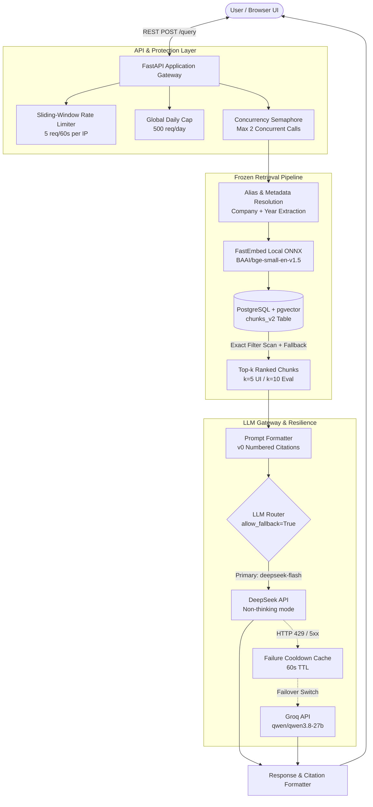

# FinVault AI: Master System Documentation & Technical Blueprint

**Version:** 1.0 (Production / Frozen Pipeline)  
**Corpus:** SEC Filings (10-K, 10-Q, 8-K) via FinanceBench Benchmark  
**Primary Engine:** FastEmbed ONNX Runtime (`BAAI/bge-small-en-v1.5`), PostgreSQL + `pgvector` (`chunks_v2`), DeepSeek (`deepseek-flash`)  
**Frozen Config Hash:** `357e5de5955c06edec0c892289a2acdb3fefdebaa916ef8e302af52e82d03ebb`  

---

## Table of Contents
1. [Executive Summary & Core Philosophy](#1-executive-summary--core-philosophy)
2. [System Architecture & End-to-End Flow](#2-system-architecture--end-to-end-flow)
3. [Corpus & Dataset Engineering](#3-corpus--dataset-engineering)
4. [Document Ingestion & Chunking v2](#4-document-ingestion--chunking-v2)
5. [Embedding Engine: PyTorch vs. FastEmbed ONNX Ablation](#5-embedding-engine-pytorch-vs-fastembed-onnx-ablation)
6. [Vector Database, Schema & Index Optimization](#6-vector-database-schema--index-optimization)
7. [Retrieval Pipeline & Ablation Study](#7-retrieval-pipeline--ablation-study)
8. [LLM Gateway & Dual-Provider Resilience](#8-llm-gateway--dual-provider-resilience)
9. [Prompt Engineering & Anti-Hallucination Guardrails](#9-prompt-engineering--anti-hallucination-guardrails)
10. [Evaluation Harness, Guards & Statistical Methodology](#10-evaluation-harness-guards--statistical-methodology)
11. [Empirical Benchmark Results (Dev vs. Held-Out Test)](#11-empirical-benchmark-results-dev-vs-held-out-test)
12. [Known Failure Modes & Architectural Limitations](#12-known-failure-modes--architectural-limitations)
13. [Operations & Reproduction Runbook](#13-operations--reproduction-runbook)

---

## 1. Executive Summary & Core Philosophy

FinVault AI is an enterprise-grade financial Retrieval-Augmented Generation (RAG) system engineered to answer complex qualitative and quantitative questions over SEC regulatory filings (Forms 10-K, 10-Q, 8-K) with page-level citations, mathematical auditability, and zero tolerance for hallucination.

### The "Smallest Honest RAG" Principles
1. **Zero Fake Answers / Zero Mock Fallbacks:** When context is missing, incomplete, or ambiguous, the system must explicitly abstain rather than fabricate figures or speculate.
2. **Deterministic Citations:** Every factual assertion must be attributed to a specific numbered excerpt containing the exact company, filing document, fiscal year, and zero-indexed page number.
3. **No Inference from Absence:** In financial auditing, the absence of a line item does not imply zero (e.g., absence of a restructuring line in an income statement summary does not mean restructuring costs were \$0.00). The model is strictly prohibited from inferring zero.
4. **Frozen Reproducibility:** Every empirical metric is backed by frozen configurations, cryptographic SHA-256 config hashes, git-clean tree guards, and 95% Wilson score confidence intervals.

---

## 2. System Architecture & End-to-End Flow

FinVault AI couples a high-throughput, low-latency FastAPI backend with an ONNX-accelerated vector retrieval pipeline and an OpenAI-compatible LLM gateway featuring automatic cooldown-based fallback.



### Component Stack
- **Web Frontend:** Vanilla HTML5, modern CSS3 (custom design system with amber alert banners), and asynchronous vanilla JavaScript. Zero Node.js runtime or frontend bundle build step.
- **API Framework:** FastAPI on Python 3.11 with Uvicorn, Pydantic v2 data models, and asynchronous request handling.
- **Embedding Subsystem:** `fastembed` with ONNX Runtime (`BAAI/bge-small-en-v1.5`), generating 384-dimensional dense vectors locally on Apple Silicon / x86 without PyTorch dependencies.
- **Database:** PostgreSQL 16 hosted on Neon Serverless with `pgvector` 0.5+ vector similarity engine.
- **Primary LLM:** DeepSeek `deepseek-flash` (`https://api.deepseek.com`) operating in strict non-thinking mode (`"thinking": {"type": "disabled"}`) with temperature 0.0.
- **Fallback LLM (Chatbot UI Only):** Groq `qwen/qwen3.8-27b` (`https://api.groq.com/openai/v1`).
- **Evaluation Judge:** Independent DeepSeek instance running a calibrated financial QA rubric with scale-aware numeric tolerance pre-matching.

---

## 3. Corpus & Dataset Engineering

The system is evaluated against the FinanceBench benchmark, curated by Patronus AI.

### Corpus Parameters
- **Documents:** 84 SEC regulatory filings across 32 publicly traded US corporations.
- **Filing Types:** Form 10-K (Annual Reports), Form 10-Q (Quarterly Reports), Form 8-K (Current Reports), and Earnings Call Transcripts.
- **Total Ingested Chunks (`chunks_v2`):** 32,289 clean text chunks.
- **Total Questions:** 150 benchmark questions with gold answers, gold justifications, and page-level ground truth evidence.
- **Split Design (Seed 42):**
  - **Dev Split (n = 75):** Used for retrieval ablation, prompt tuning, and abstention thresholding.
  - **Held-Out Test Split (n = 75):** Strictly sealed until the prompt, retrieval pipeline, and configuration hash were frozen and committed.

### Covered Companies (32)
3M, Activision Blizzard, Adobe, AES Corporation, Amazon, Amcor, American Express, American Water Works, Best Buy, Block (Square), Boeing, Coca-Cola, Corning, Costco, CVS Health, Foot Locker, General Mills, Johnson & Johnson, JPMorgan Chase, Kraft Heinz, Lockheed Martin, MGM Resorts, Microsoft, Netflix, Nike, PayPal, PepsiCo, Pfizer, Ulta Beauty, Verizon, Walmart, AMD.

---

## 4. Document Ingestion & Chunking v2

Standard character-count or recursive-character splitters introduce catastrophic failures in financial documents by bisecting financial tables across row boundaries and generating token decoding artifacts.

### The Chunking v2 Architecture (`scripts/ingest_chunks_v2.py`)
1. **Zero Decode Artifacts:** Text is extracted page-by-page using PyPDF and sliced strictly as substrings of the original page string using character start/end offsets. No token re-decoding (e.g. byte-fallback corruption) occurs.
2. **Table Preservation up to 800 Tokens:**
   - Heuristic table detection scans for multi-column whitespace layouts paired with numerical patterns (`$`, `,`, `.`, `%`, `(negative)`).
   - Standard prose chunks are capped at 400 tokens with 1-line overlap.
   - When a table is detected, the chunk boundary expands up to 800 tokens to keep financial statements (Balance Sheet, Cash Flow, Income Statement) intact within a single context window.
   - Oversized tables exceeding 800 tokens are split cleanly at row boundaries, and the table header row is automatically repeated at the top of subsequent child chunks.
3. **Context Header Injection for Embeddings:**
   Financial tables often contain anonymous column headers (e.g. "Year Ended December 31, 2022"). To ensure dense semantic retrieval succeeds, a synthetic context header is prepended **only to the text sent to the embedding model**:
   ```text
   COMPANY | FORM | FISCAL YEAR | PAGE | NEAREST SECTION HEADING
   ```
   The raw chunk stored in PostgreSQL and delivered to the LLM retains the pristine text without header pollution.
4. **Validation Bar:** Ingestion requires $\ge 99.5\%$ character coverage per page and 100% pass on page-substring containment tests.

---

## 5. Embedding Engine: PyTorch vs. FastEmbed ONNX Ablation

To optimize deployment footprint, cold-start latency, and inference throughput, FinVault AI evaluated FastEmbed (ONNX Runtime) against the standard Hugging Face `sentence-transformers` (PyTorch) pipeline using `BAAI/bge-small-en-v1.5` (384 dimensions).

### Measured Benchmark (Apple Silicon M-Series)

| Metric | SentenceTransformers (PyTorch) | FastEmbed (ONNX Runtime) | Measured Delta |
| :--- | :--- | :--- | :--- |
| **Virtualenv Disk Footprint** | 1,200 MB | 239 MB | **-80.1%** |
| **Peak RSS (Cold Model Load + 1st Query)** | 540.73 MB | 216.70 MB | **-59.9%** |
| **1st Query Cold-Start Latency** | 3,630 ms | 60 ms | **-98.3%** |
| **100-Query Batch Embedding Time** | 0.5513s (5.51 ms/query) | 0.3155s (3.16 ms/query) | **-42.8%** |
| **Cosine Similarity to Reference Embeddings (N=100)** | 1.000000 | Min: 0.999998, Mean: 0.999999 | **99.9999% identical** |

**Conclusion:** FastEmbed achieves virtually mathematical parity with PyTorch while eliminating nearly 1 GB of dependency bloat, slashing cold-start time by 98%, and reducing peak RAM by 60%.

---

## 6. Vector Database, Schema & Index Optimization

The database is built on PostgreSQL 16 with the `pgvector` extension.

### Schema Definition (`chunks_v2`)
```sql
CREATE EXTENSION IF NOT EXISTS vector;

CREATE TABLE IF NOT EXISTS chunks_v2 (
    id SERIAL PRIMARY KEY,
    company VARCHAR(100) NOT NULL,
    doc_name VARCHAR(255) NOT NULL,
    year INTEGER,
    page INTEGER NOT NULL,
    chunk_index INTEGER NOT NULL,
    text TEXT NOT NULL,
    embedding VECTOR(384) NOT NULL
);

-- B-Tree indexes for fast exact partitioned scans
CREATE INDEX IF NOT EXISTS idx_chunks_v2_company ON chunks_v2 (company);
CREATE INDEX IF NOT EXISTS idx_chunks_v2_year ON chunks_v2 (year);
CREATE INDEX IF NOT EXISTS idx_chunks_v2_comp_year ON chunks_v2 (company, year);

-- HNSW Vector Index for Cosine Distance
CREATE INDEX IF NOT EXISTS idx_chunks_v2_embedding_hnsw 
ON chunks_v2 USING hnsw (embedding vector_cosine_ops)
WITH (m = 16, ef_construction = 64);
```

### Search Query & Missing-Year Comparative Filing Fallback
When financial queries specify a company and year, vector search applies exact SQL filtering:
```sql
SELECT id, company, doc_name, year, page, chunk_index, text,
       1 - (embedding <=> %s::vector) AS similarity_score
FROM chunks_v2
WHERE embedding IS NOT NULL
  AND company = %s
  AND year = %s
ORDER BY embedding <=> %s::vector
LIMIT %s;
```

#### Comparative Filing Fallback Mechanism
A key finding during dev error analysis: SEC filings present 2- or 3-year comparative tables (e.g. FY2022 Form 10-K includes full financial statements for FY2021 and FY2020). If a query asks for a company's FY2018 figure, but the corpus only contains the FY2020 10-K (which includes FY2018 comparative columns), filtering strictly on `year = 2018` yields 0 chunks.

FinVault AI implements an automated **fallback**: if filtering on both `company` and `year` returns 0 results, the query automatically re-executes with `company = used_company` and `year = NULL`. This single fallback improved dev hit rate significantly without polluting cross-company results.

---

## 7. Retrieval Pipeline & Ablation Study

Retrieval configurations were rigorously evaluated across both splits using two ground-truth criteria:
1. **Page Hit@k:** Whether any retrieved chunk originates from the exact document and zero-indexed page specified in gold evidence.
2. **Token Recall Hit@k ($\ge 0.8$):** Whether any retrieved chunk contains $\ge 80\%$ token overlap with the gold evidence excerpt.

### Retrieval Configurations
- **Config A (Vanilla Baseline):** Unfiltered top-k dense vector search across all 32,289 chunks.
- **Config B (Company Filtered):** Top-k vector search with company filter derived from query text.
- **Config C (Inferred Company + Year with Missing-Year Fallback):** Uses regex alias engine (`config/aliases.json`) to extract company and fiscal year, applying comparative fallback when year-specific queries yield empty sets.
- **Oracle:** Uses ground-truth company and year from the benchmark dataset.

### Held-Out Test Split Retrieval Benchmark (n = 75)

| Configuration | Page Hit@10 | Page Hit Rate | 95% Wilson CI | Token Hit@10 ($\ge 0.8$) | Token Hit Rate | 95% Wilson CI |
| :--- | :--- | :--- | :--- | :--- | :--- | :--- |
| **Config A (Vanilla)** | 28 / 75 | 37.3% | [27.3%, 48.6%] | 17 / 75 | 22.7% | [14.7%, 33.3%] |
| **Config C (Inferred Pipeline)** | **42 / 75** | **56.0%** | **[44.7%, 66.8%]** | **24 / 75** | **32.0%** | **[22.5%, 43.2%]** |
| **Oracle (Gold Co + Yr)** | 43 / 75 | 57.3% | [46.0%, 68.0%] | 25 / 75 | 33.3% | [23.7%, 44.6%] |

**Key Finding:** Config C captures 42 out of 43 possible Oracle hits (97.7% of Oracle performance), outperforming the vanilla baseline by +18.7 percentage points on Page Hit rate.

---

## 8. LLM Gateway & Dual-Provider Resilience

FinVault AI's generation layer is powered by an OpenAI-compatible HTTP client designed for zero-crash stability, response caching, and rate-limit pacing.

### Dual-Provider Architecture
1. **Primary Provider:** DeepSeek (`https://api.deepseek.com`, model `deepseek-flash`). Configured with temperature `0.0`, `max_tokens=1024`, and `"thinking": {"type": "disabled"}` to enforce pure, deterministic factual generation.
2. **Fallback Provider:** Groq (`https://api.groq.com/openai/v1`, model `qwen/qwen3.8-27b`). Used exclusively for user-facing chatbot queries when DeepSeek is unreachable or rate-limited.
3. **Strict Evaluation Isolation:** In all benchmark and evaluation code, fallback is strictly forbidden (`allow_fallback=False`). Any API error raises an immediate exception, fails that question loudly, and records the failure in the test metadata.

### Cooldown Caching (`app/core/llm.py`)
To prevent cascading latency when the primary endpoint is experiencing an outage or 429 rate limits, FinVault AI maintains an in-memory failure cooldown cache:
- When the primary endpoint fails, its `(base_url, model, key_fingerprint)` is recorded with a timestamp.
- For the next 60 seconds (`_FAILURE_COOLDOWN_SECONDS`), subsequent chatbot requests route directly to Groq fallback without wasting round-trips on the dead primary.
- The UI displays an amber notification: `Primary model (deepseek-flash) failed: <error>. Now switching to fallback model: qwen/qwen3.8-27b`.
- Once the 60-second cooldown expires, the primary endpoint is retried.

---

## 9. Prompt Engineering & Anti-Hallucination Guardrails

### Frozen Prompt Template (`v0`)
```text
You are a financial analyst answering questions strictly based on the provided SEC filing excerpts.

CONTEXT:
{context_str}

USER QUESTION:
{query}

INSTRUCTIONS:
1. Answer the question using ONLY facts directly mentioned in the CONTEXT above.
2. For every factual claim, cite the relevant source using its bracketed number, e.g. [1], [2].
3. If the context does not contain enough information to answer the question, state clearly: "I cannot answer this question based on the provided filing excerpts." Do not speculate or invent numbers.
4. If a needed figure or fact is not explicitly stated in the excerpts, state clearly that it is not in the excerpts; never infer, assume, or report zero or none simply because it is absent.
5. Keep the answer direct, factual, and concise.

ANSWER:
```

### The AES Restructuring Case Study (Instruction 4)
In `financebench_id_01319` ("What was AES Corporation's restructuring costs for FY2022?"), the retrieved excerpts from the Statement of Operations listed Cost of Sales, G&A, Impairments, and Non-Operating Expenses, but omitted any restructuring line item.
- Without Instruction 4, standard models frequently infer: *"Since restructuring costs are not listed, restructuring costs were zero."*
- **Audit Reality:** In GAAP accounting, restructuring costs may be embedded within G&A or disclosed in footnote Note 18. Inferring zero from absence is an audit violation.
- **Instruction 4 Resolution:** Guarantees that the model states: *"Restructuring costs are not explicitly stated in the provided excerpts, and I cannot report a figure (including zero) based on the provided context."*

### Prompt Tuning Ablation: `v0` vs `v1`
During dev evaluation, an iteration (`v1`) was tested with an additional instruction to verify numeric ordering before comparing cash flow magnitudes.

| Split: Dev (n = 75) | Prompt `v0` (Frozen) | Prompt `v1` (Candidate) | Delta |
| :--- | :--- | :--- | :--- |
| **Overall Correct** | 30 / 75 (40.0%) | 30 / 75 (40.0%) | 0 |
| **Overall Wrong** | **6 / 75 (8.0%)** | 11 / 75 (14.7%) | +5 wrong |
| **Overall Abstained** | **39 / 75 (52.0%)** | 34 / 75 (45.3%) | -5 abstained |
| **Accuracy Among Attempted** | **30 / 36 (83.3%)** | 30 / 41 (73.2%) | **-10.1%** |
| **Conditional on Page Miss Abstained** | **26 / 30 (86.7%)** | 24 / 30 (80.0%) | -6.7% |

**Result:** `v1` created prompt drift, making the model overly eager to attempt answers on incomplete context. `v0` was frozen for its superior accuracy among attempted (83.3%) and lower error rate (8.0%).

---

## 10. Evaluation Harness, Guards & Statistical Methodology

The evaluation harness (`eval/run_answer_eval.py`) enforces rigorous guards against data leakage and benchmark contamination.

### Enforcement Guards
1. **Clean Git Working Tree Guard:** Before executing against the held-out test split, the script runs `git status --porcelain`. Any uncommitted file, modification, or untracked script immediately aborts the run.
2. **Cryptographic Config Hash Check:** The configuration payload (prompt template, retriever settings, aliases hash, judge rubric, model parameters) is canonicalized and hashed using SHA-256:
   ```json
   {
     "config_hash": "357e5de5955c06edec0c892289a2acdb3fefdebaa916ef8e302af52e82d03ebb",
     "generator_model": "deepseek-flash",
     "judge_model": "deepseek-flash",
     "prompt_version": "v0",
     "retriever": {
       "aliases_sha256": "3cb1f09bbfa5819777174db7667f33d02d33418fe7c7dbf6a41f6e1f0e42777c",
       "embedding_model": "BAAI/bge-small-en-v1.5",
       "metadata_mode": "inferred_config_c_with_missing_year_fallback",
       "table": "chunks_v2",
       "top_k": 10
     }
   }
   ```
   The held-out run requires `--frozen-config-hash 357e5de5955c...`. Any deviation aborts execution.
3. **Single-Write Immutability:** Test split output files cannot be overwritten without an explicit `--force` flag.
4. **Resumable Token-Paced JSONL Cache:** Both answer generation and LLM judge verdicts are cached to disk by hash keys. Interrupted runs resume seamlessly without re-billing tokens or repeating API calls.
5. **95% Wilson Score Confidence Intervals:** All proportions are reported with asymmetrical Wilson score intervals:
   $$w = \frac{p + \frac{z^2}{2n} \pm z \sqrt{\frac{p(1-p)}{n} + \frac{z^2}{4n^2}}}{1 + \frac{z^2}{n}} \quad (z = 1.96)$$

### Two-Stage Evaluation Scoring
- **Stage 1 (Numeric / Currency / Percentage Tolerance Match):**
  If gold is purely numerical (e.g. `$1,577.00`, `4.2%`), text is parsed with scale-awareness (`$389 million` $\rightarrow 3.89 \times 10^8$). Matches within 1.5% tolerance are automatically scored `correct` without LLM judge bias.
- **Stage 2 (LLM Judge with Fixed Rubric):**
  Qualitative and reasoning queries are evaluated by `deepseek-flash` using a strict binary rubric (1 = correct, 0 = wrong). Abstentions on unanswerable context are categorized as `abstained`, never marked `wrong`.

---

## 11. Empirical Benchmark Results (Dev vs. Held-Out Test)

Evaluated under frozen configuration `357e5de5955c` across both 75-question splits.

| Metric | Dev Split (n = 75) | Held-Out Test Split (n = 75) |
| :--- | :--- | :--- |
| **Overall Correct** | 30 / 75 (40.0%) `[29.7%, 51.3%]` | 30 / 75 (40.0%) `[29.7%, 51.3%]` |
| **Overall Wrong** | 6 / 75 (8.0%) `[3.7%, 16.4%]` | 9 / 75 (12.0%) `[6.4%, 21.3%]` |
| **Overall Abstained** | 39 / 75 (52.0%) `[40.9%, 62.9%]` | 36 / 75 (48.0%) `[37.1%, 59.1%]` |
| **Accuracy Among Attempted** | **30 / 36 (83.3%)** `[68.1%, 92.1%]` | **30 / 39 (76.9%)** `[61.7%, 87.4%]` |
| **Retrieval Page Hit@10** | 45 / 75 (60.0%) `[48.7%, 70.3%]` | 41 / 75 (54.7%) `[43.4%, 65.4%]` |
| **Retrieval Token Hit@10 ($\ge 0.8$)** | 19 / 75 (25.3%) `[16.9%, 36.2%]` | 24 / 75 (32.0%) `[22.5%, 43.2%]` |
| **Page Hit: Correct** | 28 / 45 (62.2%) `[47.6%, 74.9%]` | 26 / 41 (63.4%) `[48.1%, 76.4%]` |
| **Page Hit: Wrong** | 4 / 45 (8.9%) `[3.5%, 20.7%]` | 6 / 41 (14.6%) `[6.9%, 28.4%]` |
| **Page Hit: Abstained** | 13 / 45 (28.9%) `[17.7%, 43.4%]` | 9 / 41 (22.0%) `[12.0%, 36.7%]` |
| **Page Miss: Abstained (Faithful Abstention)** | **26 / 30 (86.7%)** `[70.3%, 94.7%]` | **27 / 34 (79.4%)** `[63.2%, 89.7%]` |
| **Page Miss: False Answers (Hallucination)** | 2 / 30 (6.7%) `[1.8%, 21.3%]` | 3 / 34 (8.8%) `[3.0%, 23.0%]` |
| **API Errors / Failures** | 0 | 0 |
| **Total Tokens Consumed** | 199,686 | 188,401 |

---

## 12. Known Failure Modes & Architectural Limitations

Detailed failure analysis from the evaluation run:

1. **Cross-Year Semantic Collision:**
   Generic financial queries (e.g., "What was the capital expenditure for FY2018?") match the identical table rows across subsequent filings (FY2020, FY2021). If the historical filing is missing, the model honestly abstains because the required period is omitted from top-10 chunks.
2. **Multi-Segment Disclosure Truncation:**
   In queries requiring exhaustive listings (e.g. `financebench_id_00995`: "What are AMD's major product lines as of FY2022?"), products span narrative descriptions across 5+ pages. Top-10 retrieval retrieves only a subset of pages, causing partial coverage.
3. **Reporting Segment Taxonomy vs. Geographic Lists:**
   In `financebench_id_01028` (American Express principal operating geographies), the model extracted textual mentions of countries and office footprints, whereas the gold rubric expected the four high-level reporting segments (`United States`, `EMEA`, `APAC`, `LACC`).
4. **Implicit Footnote Arithmetic:**
   In `financebench_id_00080` (PayPal working capital), current assets and liabilities are distributed across consolidated balance sheets and customer fund obligations notes. Complex multi-table subtraction across distinct footnotes remains a boundary case for top-10 single-turn retrieval.

---

## 13. Operations & Reproduction Runbook

### Local Environment Setup
```bash
# 1. Clone & activate virtual environment
python3 -m venv venv
source venv/bin/activate

# 2. Install dependencies
pip install -r requirements.txt

# 3. Configure environment variables (.env)
cp .env.example .env
# Edit .env with your Neon DATABASE_URL, LLM_API_KEY, and LLM_BASE_URL
```

### Starting the Server
```bash
uvicorn app.main:app --reload --host 127.0.0.1 --port 8000
```
Open [http://localhost:8000](http://localhost:8000) to access the interactive web interface.

### Running Evaluations

#### 1. Dev Split Answer Evaluation (Prompt v0)
```bash
./venv/bin/python3 eval/run_answer_eval.py --split dev --prompt-version v0
```

#### 2. Held-Out Test Evaluation (Enforcing Clean Tree & Frozen Hash)
```bash
./venv/bin/python3 eval/run_answer_eval.py \
  --split test \
  --prompt-version v0 \
  --frozen-config-hash 357e5de5955c06edec0c892289a2acdb3fefdebaa916ef8e302af52e82d03ebb \
  --generate-reviews
```

#### 3. Inspect Generated Human Review Files
- **Judge Verdicts (20 sampled verdicts):** [eval/results/judge_verdicts_review_20_test_357e5de5.md](file:///Users/ayushpratapsingh/dev/Projects/FinVaultAI/eval/results/judge_verdicts_review_20_test_357e5de5.md)
- **Citation Support Pairs (30 sampled non-abstained claims):** [eval/results/citation_support_review_30_test_357e5de5.md](file:///Users/ayushpratapsingh/dev/Projects/FinVaultAI/eval/results/citation_support_review_30_test_357e5de5.md)

---
*FinVault AI — Smallest Honest RAG Pipeline.*
